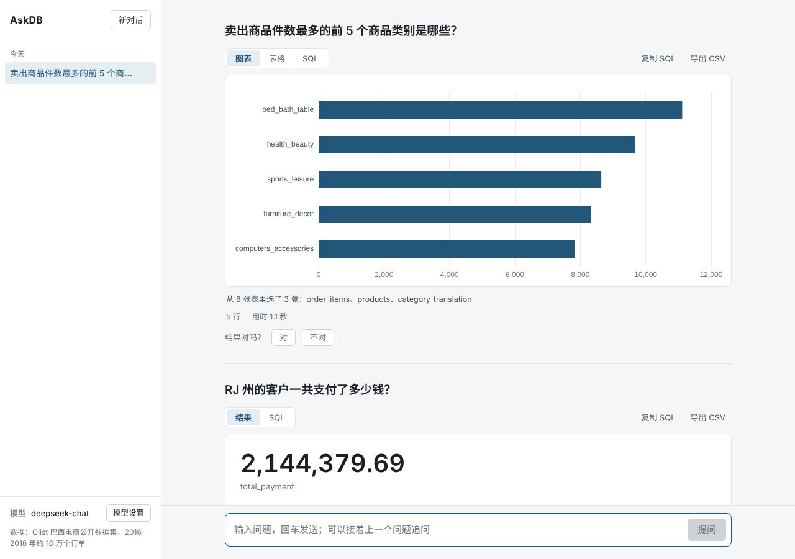
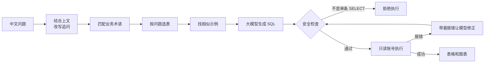

<div align="center">

# AskDB 问数

**用中文提问，自动生成 SQL、执行并画成图表的数据查询助手**

基于 Spring AI 的 NL2SQL 系统：按问题选表、业务词典、多轮追问、可调用工具的 Agent 模式、三层 SQL 安全防护，并用自建评测集量化每项改进的效果。

[](https://github.com/Calvin1989/AskDB/actions/workflows/ci.yml)


[快速开始](#快速开始) · [工作原理](#工作原理) · [评测结果](#评测结果) · [设计文档](docs/architecture.md)



</div>

## 能做什么

- **中文提问，直接出结果**：自动生成 SQL 并执行，结果按数据形态自动选择大字、柱状图或折线图，SQL 可查看、复制，结果可导出 CSV
- **多轮追问**：问完"RJ 州的客户一共支付了多少钱？"，接着问"那 SP 州呢？"就行，页面会显示它理解成了什么
- **过程看得见**：用到了哪些业务术语、从 8 张表里选了哪几张、是否在自动修正，处理时实时推送（SSE）
- **Agent 模式（可选）**：写 SQL 前，模型可以自己查看某一列存了哪些值、试运行 SQL 检查结果，不用凭感觉猜"代金券"在库里存的是 `voucher`
- **越用越准**：结果点"对"会进入示例库，以后遇到相似问题时交给模型参考
- **模型随时切换**：DeepSeek、通义千问或任何 OpenAI 兼容服务，在页面上填 Key 即可，Key 只保存在后端

## 评测结果

在 [Olist 巴西电商数据集](https://www.kaggle.com/datasets/olistbr/brazilian-ecommerce)（8 张表，约 10 万个订单）上自建题集，按**执行结果**判分，考核集每组跑 3 次取平均。模型 deepseek-chat。

| 考核集（22 题） | 对照组 | AskDB | |
|---|---|---|---|
| 执行准确率 | 81.8% | **89.4%** | +7.6 个百分点 |
| 平均输入 token | 1220 | **710** | −42% |

对照组把全部表结构直接交给模型；AskDB 打开选表、业务词典、示例库和自动修正，两组用同一份提示词。题集分成调参集和考核集，只在调参集上分析错因、调整提示词。

多轮追问单独有 12 题的追问集：不改写时只能答对 2 题（16.7%），先结合上文改写再查询后答对 11 题（91.7%）。

Agent 模式也做了同样的对比：准确率基本持平（90.9% vs 89.4%），输入 token 却是 2.2 倍，因为字段注释写清楚后模型几乎不需要调用工具，所以默认关闭。方法、分类结果、Agent 对比和局限见 [评测文档](docs/evaluation.md)。

## 工作原理



| 设计 | 解决什么问题 |
|---|---|
| **按问题选表** | 表结构全给模型，又费 token 又容易选错表。按关键词给表打分，再沿表之间的关联补上 JOIN 需要的中间表 |
| **业务词典** | "GMV""复购客户"有固定口径，模型自己猜会算错。问题里出现这些词时，把定义一起交给模型 |
| **先改写再查询** | "那 SP 州呢？"里没有"支付"，直接选表会选错。先结合上文改写成完整问题，后面每一步都用完整问题 |
| **三层安全防护** | JSqlParser 解析后只放行单条 SELECT、禁止跨库；驱动禁止多语句；数据库用只读账号。模型生成了 `DELETE` 也执行不了 |
| **报错自动修正** | SQL 执行报错时，把报错交给模型改写后重试，最多 2 次 |
| **Agent 工具调用** | 模型看不到数据，常猜错字段取值。给它三个工具：看表结构、看某列常见取值、试运行 SQL；工具同样经过安全检查，调用轮数有上限 |

每一项都能在配置里单独关掉，用来做对照实验。完整设计见 [architecture.md](docs/architecture.md)。

## 快速开始

需要 [Docker](https://www.docker.com/) 和一个大模型 API Key（[DeepSeek](https://platform.deepseek.com/) 或通义千问）。

1. 下载 [Olist 数据集](https://www.kaggle.com/datasets/olistbr/brazilian-ecommerce)，把 8 个 CSV 放到项目的 `data/olist/` 下
2. 复制 `.env.example` 为 `.env`，填上两个数据库密码
3. 运行：

```bash
docker compose run --rm init   # 第一次：建表、导入数据、建只读账号，约 2 分钟
docker compose up -d           # 启动
```

打开 http://localhost:8088 ，点左下角"模型设置"填入 API Key，就可以提问了。

不用 Docker、要改代码或跑评测，见 [本地开发](docs/development.md)。

## 技术栈

| | |
|---|---|
| 后端 | Java 17 · Spring Boot 3.4 · Spring AI 1.0 · JdbcTemplate · JSqlParser |
| 存储 | MySQL 8 · Redis（答案缓存、分布式限流） |
| 前端 | Vue 3 · TypeScript · Vite · ECharts |
| 工程 | JUnit 5 · Testcontainers（真实 MySQL 上测安全防护）· Vitest · GitHub Actions · Docker Compose |

## 项目结构

```
src/main/java/com/askdb
├── core         一次提问的总流程（只做编排）、缓存、调用日志
├── llm          调模型：改写追问、生成和修正 SQL、模型设置
├── agent        Agent 模式：给模型用的工具、工具调用循环
├── schema       读取表结构、按问题选表、表之间的关联
├── glossary     业务词典
├── examples     示例库
├── sql          SQL 安全检查和执行
├── ratelimit    限流（内存 / Redis 滑动窗口）
├── eval         评测：跑题、比较结果、出报告
└── api          HTTP 接口、SSE 进度推送
askdb-web/       前端（Vue 3）
docs/            设计文档、评测文档、业务术语定义
```

## 文档

- [设计文档](docs/architecture.md)：每一步怎么做、为什么这样做，以及测试怎么覆盖
- [评测文档](docs/evaluation.md)：判分方法、题集、完整结果、怎么跑
- [本地开发](docs/development.md)：不用 Docker 在本机运行
- [业务术语](docs/business-terms.md)：GMV、复购客户等指标的口径

## License

[MIT](LICENSE)
